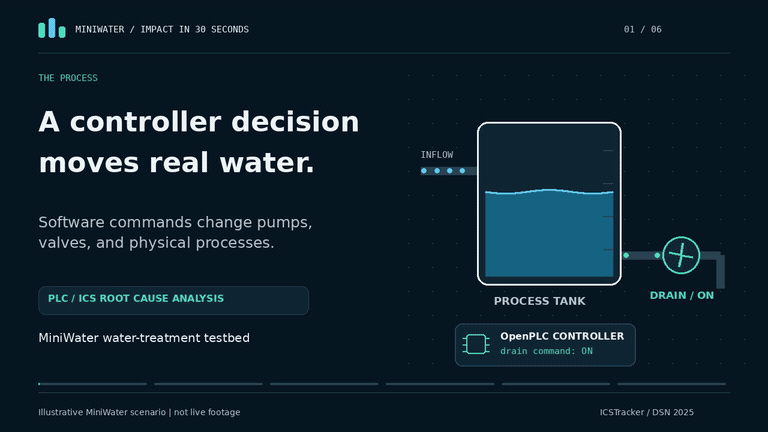
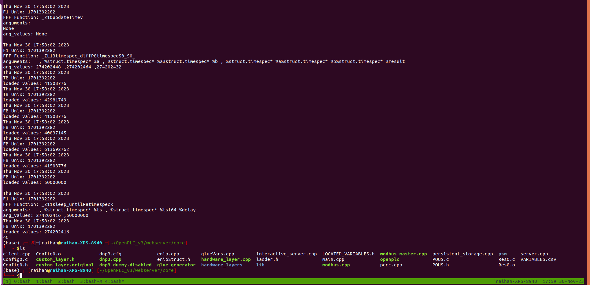

# MiniWater: PLC Instrumentation for ICS Root Cause Analysis

[](https://github.com/iotrustlab/miniwater-raspberry-pi-instrumentation/actions/workflows/ci.yml)
[](https://doi.org/10.1109/DSN64029.2025.00031)
[](LICENSE)

**Trace the controller decisions behind a physical process failure.** This repository provides an instrumented OpenPLC runtime for **PLC/ICS root cause analysis** on the **MiniWater water-treatment testbed**. It connects compiler-level execution visibility with the practical problem of investigating unsafe pump, valve, and chemical-dosing behavior in industrial control systems.

The work sits at the intersection of **cyber-physical security, LLVM instrumentation, embedded Linux, and industrial automation**, supporting the research presented in [*ICSTracker: Backtracking Intrusions in Modern Industrial Control Systems*, IEEE/IFIP DSN 2025](https://doi.org/10.1109/DSN64029.2025.00031).

**[Paper](https://doi.org/10.1109/DSN64029.2025.00031) · [MiniWater testbed configuration](https://github.com/iotrustlab/miniwatertreatment/tree/main) · [Full ICSTracker framework](https://github.com/icstracker/icstracker) · [Archived research artifact](https://doi.org/10.5281/zenodo.15109706)**

## See the impact in 30 seconds

[](docs/media/miniwater-impact.mp4)

**[Watch or download the MP4](https://github.com/iotrustlab/miniwater-raspberry-pi-instrumentation/raw/refs/heads/main/docs/media/miniwater-impact.mp4)** · [Static preview](docs/media/miniwater-impact-poster.jpg) · [Transcript and animation source](docs/media/README.md)

An illustrated MiniWater overflow scenario shows how a software decision becomes a physical consequence, and how this repository's execution evidence supports investigation with the full ICSTracker framework. The silent animation includes on-screen captions; its process states and trace rows are illustrative.

## Why controller visibility matters

A tank overflow is an observable symptom. The investigation needs to explain which input, state transition, or control decision stopped the drainage pump, and how that decision relates to the intrusion. Network traffic and operating-system logs alone leave gaps inside PLC logic.

MiniWater makes this problem concrete through raw-water processing, chemical dosing, and treated-water delivery. Its Raspberry Pi/OpenPLC controllers provide an accessible platform for studying how malicious control decisions propagate into physical consequences. The [companion testbed repository](https://github.com/iotrustlab/miniwatertreatment/tree/main) provides hardware mappings, PLC configurations, attack experiments, and a water-treatment simulator.

This repository supplies the **instrumentation and runtime component** of that investigation workflow. The full ICSTracker framework performs physical-semantics recovery, cross-iteration dependency reconstruction, provenance analysis, and correlation with OS events.

## Technical highlights

| Engineering area | What to explore |
| --- | --- |
| **Compiler instrumentation** | Clang 14's legacy pass manager loads `instrument.so` during PLC compilation, with debug information and LLVM value names preserved. |
| **PLC compilation pipeline** | IEC 61131-3 Structured Text passes through the ST optimizer and MATIEC into generated C, then into the instrumented C++ runtime. |
| **Execution evidence** | The included historical trace captures timestamped function entries, argument values, and loaded values, providing evidence for downstream dependency analysis. |
| **Industrial systems integration** | OpenPLC's runtime includes Modbus, DNP3, EtherNet/IP, hardware layers, and the Python SubModule interface. |
| **Reproducible build tooling** | Configurable compiler and pass paths, explicit baseline builds, prerequisite diagnostics, failure reporting, and isolated regression tests. |

The protocol implementations, PLC engine, and compiler infrastructure build on upstream OpenPLC and its dependencies. The focus of this fork is instrumentation integration for MiniWater research.

## From PLC logic to investigation evidence


The build integration is in [`compile_program.sh`](webserver/scripts/compile_program.sh). The scan loop in [`main.cpp`](webserver/core/main.cpp) executes the compiled PLC logic between input and output updates. Process-specific wiring and control programs are documented in the [MiniWater configuration repository](https://github.com/iotrustlab/miniwatertreatment/tree/main).

<details>
<summary>View an existing instrumentation trace</summary>



This screenshot is a historical execution example supplied with the repository. Trace collection and downstream analysis must be validated for the selected compiler, instrumentation pass, and target environment.

</details>

## Attack scenarios and real-world motivation

Table II of the [ICSTracker paper](https://doi.org/10.1109/DSN64029.2025.00031) evaluates four MiniWater scenarios. Each turns a physical symptom into a concrete root cause investigation:

| MiniWater scenario | Physical consequence in the experiment | Root cause question | Paper's motivating incident or research |
| --- | --- | --- | --- |
| **Water contamination (#7)** | A manipulated dosing parameter causes excessive sodium hypochlorite (NaOCl) dosing. | Which parameter update changed the dosing decision? | Reported Florida/Oldsmar incident: [CISA, “Cyber Actors Compromise U.S. Water Treatment Facility”](https://content.govdelivery.com/accounts/USDHSCISA/bulletins/2c0cd4d). |
| **Overflow (#8)** | False data triggers premature drainage-pump shutdown and tank overflow. | Which false input propagated into the pump-off decision? | Stuxnet: [ENISA's Stuxnet analysis](https://www.enisa.europa.eu/news/enisa-news/stuxnet-analysis) and [WIRED, “Iran: Computer Malware Sabotaged Uranium Centrifuges”](https://www.wired.com/2010/11/stuxnet-sabotage-centrifuges/). |
| **Underflow (#9)** | Premature intake-pump shutdown leaves insufficient water for chemical dosing. | Which control action interrupted the upstream supply? | The paper cites [CPS-SPC 2018 research](https://doi.org/10.1145/3264888.3264896), also available as an [author preprint](https://arxiv.org/abs/1806.08110). |
| **Reverse flow (#10)** | A malicious command deactivates a check valve, permitting reverse flow as pump pressure changes. | Which command removed the flow-direction constraint? | The paper cites [ProvThings, NDSS 2018](https://doi.org/10.14722/ndss.2018.23282), with an [open paper](https://www.ndss-symposium.org/wp-content/uploads/2018/02/ndss2018_01A-2_Wang_paper.pdf). |

These are controlled testbed experiments. Stuxnet motivates the overflow experiment through manipulated control behavior; the historical incident targeted centrifuges. Underflow and reverse flow are research scenarios. The reported Oldsmar event concerned sodium hydroxide (NaOH), and its external-intrusion attribution was [subsequently disputed](https://www.wusf.org/local-state/2023-04-13/official-hack-oldsmar-city-water-treatment-plant-2021).

The threat remains relevant beyond the lab: [CISA's advisory on exploitation of Unitronics PLCs at U.S. water and wastewater facilities](https://www.cisa.gov/news-events/cybersecurity-advisories/aa23-335a) documents real compromises of industrial controllers.

**Research context:** ICSTracker evaluates **ten attack scenarios across two testbeds**, including these four MiniWater cases. Its published provenance-analysis results belong to the complete research framework; this runtime repository does not independently reproduce those benchmarks.

## Build and run

### Prerequisites and target compatibility

- A Debian-based Linux development host or Raspberry Pi environment with the OpenPLC native build dependencies.
- **Clang/LLVM 14** and an instrumentation pass built for the compiler host's architecture and LLVM ABI.
- Python 3 and the webserver virtual environment created by the installer.
- For physical MiniWater deployment, the [testbed's hardware mappings and PLC/PSM configuration](https://github.com/iotrustlab/miniwatertreatment/tree/main), with a compatible hardware driver.

**The bundled `instrument.so` is an x86-64 research binary; its pass source is not included in this checkout.** Raspberry Pi deployment needs a matching ARM build of the pass. The bundled native helper executables are also x86-64 and should be rebuilt on the target host. Obtain the matching instrumentation implementation through the [full ICSTracker artifact](https://github.com/icstracker/icstracker) or the research maintainers before attempting an instrumented Pi build.

The installer builds native dependencies and may install packages, create temporary swap, and enable an OpenPLC service. Run it in a dedicated development/testbed environment. Inspect prerequisites first; the checker reports missing dependencies without changing the machine:

```bash
git clone git@github.com:iotrustlab/miniwater-raspberry-pi-instrumentation.git
cd miniwater-raspberry-pi-instrumentation
python3 tools/check_environment.py --platform rpi
# Machine-readable report, with a nonzero exit status for missing prerequisites:
python3 tools/check_environment.py --platform rpi --json
```

### Instrumented build

Point to a compatible pass before installation. Use an absolute path when supplying a custom pass:

```bash
export CXX=clang++-14
export OPENPLC_INSTRUMENTATION_PASS=/absolute/path/to/instrument.so
./install.sh rpi
./start_openplc.sh
```

Use `./install.sh linux` for a Linux development host. The default pass path is this repository's `instrument.so`. OpenPLC's dashboard is available at `http://<host>:8080`; configure the appropriate hardware layer and upload the PLC program for the process under investigation. The inherited default account is `openplc` / `openplc`; change it before connecting the runtime to a shared testbed network.

### Explicit baseline build

For comparing an uninstrumented runtime, disable pass loading explicitly:

```bash
OPENPLC_INSTRUMENTATION=0 CXX=g++ ./install.sh linux
```

This creates an **uninstrumented baseline**. Keep the same environment settings for later program compilations; when using the dashboard, launch it with those settings as well.

| Setting | Purpose | Default |
| --- | --- | --- |
| `CXX` | Compiler executable used for PLC compilation | `clang++-14` on Linux/Pi |
| `OPENPLC_INSTRUMENTATION_PASS` | Compatible LLVM legacy-pass shared object | Repository-root `instrument.so` |
| `OPENPLC_INSTRUMENTATION` | `1` enables instrumentation; `0` selects a baseline | `1` |
| `OPENPLC_PYTHON` | Python interpreter used by the runtime launcher | `.venv/bin/python3` |

The prerequisite checker validates compiler availability and ELF architecture; a successful instrumented build is still needed to verify LLVM ABI and shared-library compatibility. The existing Dockerfile is inherited OpenPLC packaging and requires its own target/dependency validation.

## Validation and engineering quality

Run the checks without PLC hardware or system installation:

```bash
for script in install.sh background_installer.sh start_openplc.sh webserver/scripts/compile_program.sh; do
    bash -n "$script" || exit 1
done
python3 -m unittest discover -s tests -v
```

[GitHub Actions](.github/workflows/ci.yml) runs the same shell and regression checks. The tests exercise build-tool behavior in isolated fixtures and validate architecture detection without loading the instrumentation binary. They do not substitute for a native instrumented build, timing measurements, or physical-process testing on the Pi.

## Repository guide

| Path | Role |
| --- | --- |
| [`webserver/scripts/compile_program.sh`](webserver/scripts/compile_program.sh) | Structured Text compilation, instrumentation integration, and runtime linking |
| [`webserver/core/`](webserver/core/) | PLC scan loop, generated program files, protocol services, and hardware layers |
| [`webserver/core/psm/`](webserver/core/psm/) | Python SubModule interface and a starter I/O program |
| [`webserver/st_files/`](webserver/st_files/) | Existing Structured Text programs; select and verify the program for your process |
| [`instrument.so`](instrument.so) | Bundled x86-64 LLVM instrumentation pass |
| [`tools/check_environment.py`](tools/check_environment.py) | Read-only prerequisite and host-architecture diagnostics |
| [`tests/`](tests/) | Hardware-independent regression tests |
| [`utils/`](utils/) | Bundled upstream compilers and native dependencies |

## Citation and acknowledgments

If this work supports your research, cite the [ICSTracker paper](https://doi.org/10.1109/DSN64029.2025.00031):

```bibtex
@inproceedings{ahmed2025icstracker,
  title     = {ICSTracker: Backtracking Intrusions in Modern Industrial Control Systems},
  author    = {Ahmed, Md Raihan and Paul, Jainta and Li, Levi Taiji and Garcia, Luis and Zhang, Mu},
  booktitle = {2025 55th Annual IEEE/IFIP International Conference on Dependable Systems and Networks (DSN)},
  year      = {2025},
  pages     = {193--207},
  doi       = {10.1109/DSN64029.2025.00031}
}
```

This project builds on [OpenPLC Runtime v3](https://github.com/thiagoralves/OpenPLC_v3), created by Thiago Alves and contributors, and its bundled dependencies. OpenPLC source carries **GPL-3.0-or-later** notices; the license text is included in [`LICENSE`](LICENSE). Vendored components retain their own copyright and license notices. Research-paper and artifact links provide attribution; the ICSTracker paper PDF is intentionally excluded from this repository.
